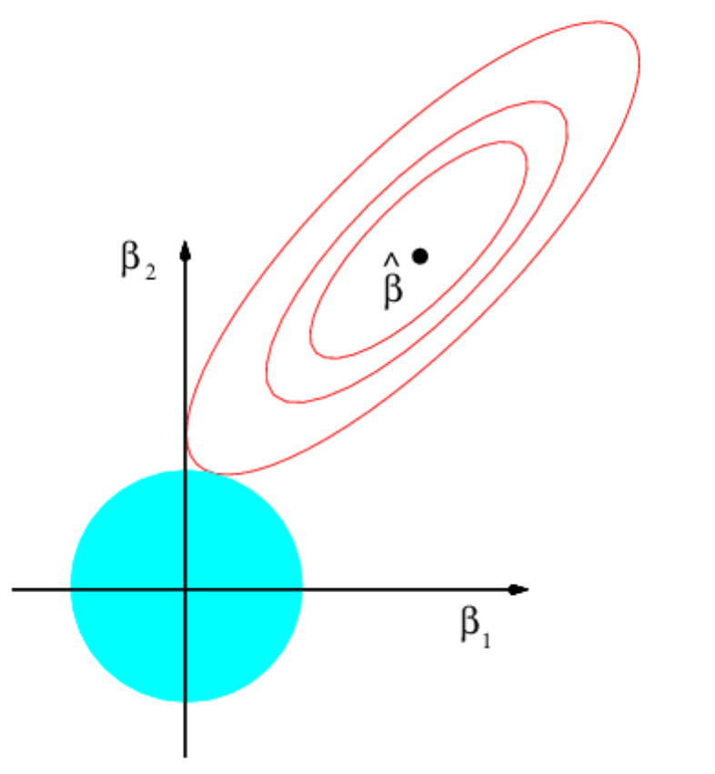
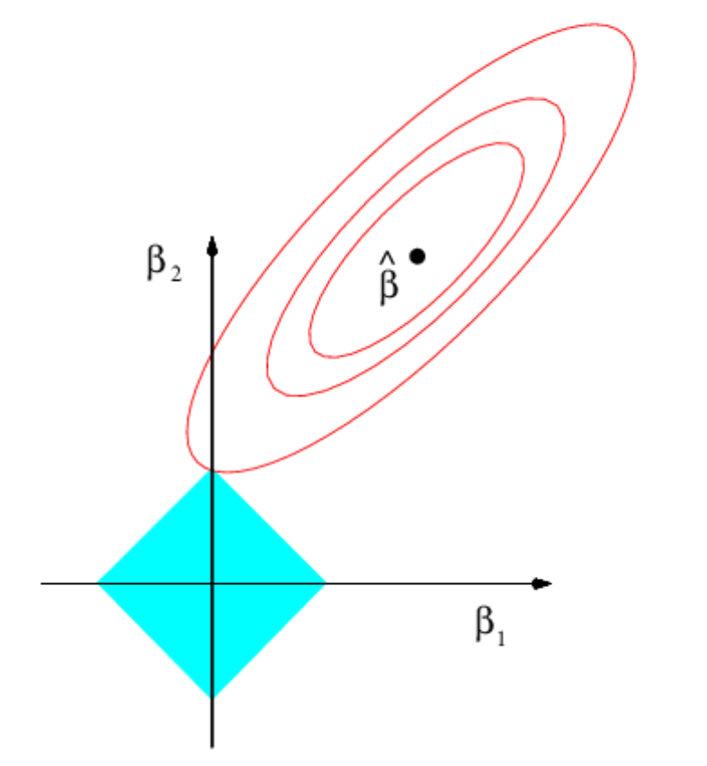

## Regularization {.title-slide}

::: {style="display: none"}
$$
\DeclareMathOperator*{\argmin}{arg\,min}
\DeclareMathOperator*{\argmax}{arg\,max}
$$
:::

```{r, echo = F, message=F, warning=F}
library(tidyverse)
library(haven)
library(knitr)
library(splines)
library(gam) # Hastie's gam package (not mgcv)
library(glmnet)
library(Matrix)
options(digits=3, knitr.kable.NA = "")
knitr::opts_chunk$set(echo = T)
```

## Previously

::: {.incremental}

- **Mixture models**
  - A **discrete** latent variable: cluster membership
  - MLE/MAP estimation via **Expectation-Maximization**

- **Item response theory**
  - A **continuous** latent trait that drives discrete responses
  - Logit/probit regression with **unobserved** regressors
  - Identification via priors (or constraints) that fix the location and scale of the latent space

:::

## This week

::: {.incremental}

- **Flexible regression**
  - Estimating $E[Y_i | X_i]$ when $X_i$ is continuous and we don't want to assume a restrictive specification
  - **Basis expansions**: polynomials, step functions, splines

- **Regularization**
  - The bias-variance trade-off
  - **Ridge** ($L_2$) and **lasso** ($L_1$) penalties
  - Ridge on a spline's slope changes: a penalty on **curvature**
  - Choosing the penalty via **cross-validation**
  - Connection to Bayes - penalties are **priors**

- **Running example**: Age and the 2020 presidential vote in the 2023 CES

:::

## Going forward

::: {.incremental}

- **Midterm 2** - In class, Wednesday, November 11
- **Week 11** - Flexible Regression: Trees and Forests
- **Week 12** - Flexible Regression: Kernels and Gaussian Processes
- **Week 13** - Causal Inference when adjusting with flexible regression models
- **Week 14** - Working with "Big" Datasets

:::

## Flexible regression

::: {.incremental}

- We've spent a lot of time estimating the **conditional expectation function** (CEF) $E[Y|X] = f(X)$.
  - But so far we've emphasized methods where we know the true functional form (e.g. a **linear** CEF)

    $$E[Y|X] = X^{\prime}\beta$$

  - Linearity is trivially satisfied when $X$ is discrete (a dummy for every value), but a potentially problematic assumption when $X$ is continuous.

- We want to keep the convenience of a model that is **linear in the parameters**, but transform $X$ to capture non-linear relationships between $Y$ and $X$.

- Define the **linear basis expansion** for a set of $M$ basis functions $h_m(X)$

  $$f(X) = \sum_{m=1}^M \beta_m h_m(X)$$

  - Once we pick the $h_m()$, this is "just" a regression of $Y$ on $h_1(X), h_2(X), \dotsc, h_M(X)$.

:::

## Example: Age and the 2020 vote

::: {.incremental}

- How does vote choice vary with **age**?
  - Age "effects": people become more conservative as they age
  - Cohort "effects": the political events that occur when a cohort comes of age have persistent effects (Boomer, Gen-X, Millennial, Zoomer) [@ghitza2023generations]
  - Functional form between age and political attitudes not clear ex-ante!

- **Data**: the 2023 Cooperative Election Study [@schaffner2024ces]
  - $Y_i$: recalled 2020 presidential vote (1 = Trump, 0 = Biden) among respondents who voted
  - $X_i$: age in years (2023 minus birth year)
  - We use the CES **survey weights** throughout, so the fits are *weighted* least squares. To keep the notation simple, the math is written unweighted.

:::

## Example: Age and the 2020 vote

```{r}
ces_raw <- read_dta("../week8/data/CCES23_Common_OUTPUT.dta.gz") # the file from Week 8
count(ces_raw, presvote20post) # value labels are in the Stata file; see the questionnaire
```

```{r}
ces <- ces_raw %>%
  mutate(age = 2023 - birthyr) %>%
  filter(presvote20post %in% 1:2, age <= 90) %>% # Biden or Trump voters; only a handful are over 90
  mutate(trump = as.numeric(presvote20post == 2),
         w = commonweight / mean(commonweight)) # survey weights, rescaled to average 1
tibble(n = nrow(ces), unweighted = mean(ces$trump), weighted = weighted.mean(ces$trump, ces$w))
```

## Example: Age and the 2020 vote

- Points are the (weighted) share voting Trump at each age, sized by the number of respondents. The line is a (weighted) linear fit.

```{r, echo=F}
age_grid <- tibble(age = 21:90)
age_means <- ces %>% group_by(age) %>% summarize(trump = weighted.mean(trump, w), n = n())
uw_red <- "#c5050c"; uw_blue <- "#0479A8"
base_plot <- ggplot() +
  geom_point(data = age_means, aes(x = age, y = trump, size = n), alpha = .35) +
  scale_size_area(max_size = 4, guide = "none") +
  coord_cartesian(ylim = c(0, 1)) +
  xlab("Age (2023)") + ylab("Share voting Trump (2020)") +
  theme_bw() + theme(text = element_text(size = 16))
add_fit <- function(p, fit, col = uw_red, lty = 1) {
  p + geom_line(data = tibble(age = age_grid$age, fit = as.vector(fit)), aes(x = age, y = fit),
                colour = col, linewidth = 1.5, linetype = lty)
}
```

```{r, echo=F, fig.align="center", fig.width=10, fig.height=5.5}
add_fit(base_plot, predict(lm(trump ~ age, data = ces, weights = w), age_grid))
```

## Polynomial basis

::: {.incremental}

- A common set of basis functions to choose is the **global polynomial** basis
  - You've probably already done this when you've included squared terms in your regressions!

- For example, for a univariate $X$, the basis for a global cubic polynomial is:

  $$h_1(X) = 1, \quad h_2(X) = X, \quad h_3(X) = X^2, \quad h_4(X) = X^3$$

- A $K$th order polynomial requires $K+1$ parameters

- However, there are some drawbacks to using a global polynomial - each observation influences the **entire** curve.
  - High-order polynomials are notoriously unstable at the **edges** of the data.

:::

## Polynomial basis

```{r}
cubic_fit <- lm(trump ~ poly(age, 3), data = ces, weights = w) # poly() uses an orthogonal version of the same basis
poly15_fit <- lm(trump ~ poly(age, 15), data = ces, weights = w)
```

```{r, echo=F, fig.align="center", fig.width=10, fig.height=5}
base_plot |> add_fit(predict(cubic_fit, age_grid), col = uw_blue) |>
  add_fit(predict(poly15_fit, age_grid)) +
  annotate("text", x = 23, y = .95, label = "Cubic", colour = uw_blue, size = 6, hjust = 0) +
  annotate("text", x = 23, y = .87, label = "15th order", colour = uw_red, size = 6, hjust = 0)
```

## Step functions

- Instead of a single **global** polynomial, fit **local** averages within regions of $X$ defined by cutpoints $\xi_1 < \xi_2 < \dotsc < \xi_M$:

  $$h_1(X) = I(X < \xi_1), \quad h_2(X) = I(\xi_1 \le X < \xi_2), \quad \dotsc, \quad h_{M+1}(X) = I(\xi_M \le X)$$

- Natural cutpoints here: **generations**: Gen Z ($\le 26$ in 2023), Millennials (27-42), Gen X (43-58), Boomers (59-77), Silent (78+)

```{r}
gen_knots <- c(26, 42, 58, 77) # the last age in each generation
step_fit <- lm(trump ~ cut(age, c(-Inf, gen_knots, Inf)), data = ces, weights = w)
```

## Step functions

```{r, echo=F, fig.align="center", fig.width=10, fig.height=6}
(base_plot + geom_vline(xintercept = gen_knots + .5, lty = 3, linewidth = 1, colour = "darkgreen")) |>
  add_fit(predict(step_fit, age_grid))
```

## Piecewise linear functions

::: {.incremental}

- Step functions are discontinuous: a 42-year-old and a 43-year-old get very different predictions.

- Instead, fit a **line** within each region, and force the lines to **connect** at the cutpoints (called **knots**):

  $$f(X) = \beta_0 + \beta_1 X + \sum_{k=1}^{K} \beta_{k+1} (X - \xi_k)_+$$

  where $(\cdot)_+$ denotes $\max(\cdot, 0)$.

- This is a **linear spline** in the **truncated power basis**. Each term $(X - \xi_k)_+$ is zero to the left of knot $\xi_k$ and a line with slope 1 to its right.

- **Interpretation**:
  - $\beta_1$ is the slope to the left of the first knot.
  - $\beta_{k+1}$ is the **change in the slope** at knot $\xi_k$.
  - The slope between $\xi_k$ and $\xi_{k+1}$ is $\beta_1 + \beta_2 + \dotsc + \beta_{k+1}$.

:::

## Linear splines

```{r}
tp_basis <- function(x, knots) { # truncated power basis: one column (x - knot)_+ per knot
  outer(x, knots, function(x, k) pmax(x - k, 0)) %>% `colnames<-`(paste0("(age-", knots, ")+"))
}
gen_spline <- lm(trump ~ age + tp_basis(age, gen_knots), data = ces, weights = w)
coef(gen_spline) %>% setNames(c("(Intercept)", "age", colnames(tp_basis(0, gen_knots))))
```

```{r, echo=F, fig.align="center", fig.width=10, fig.height=4.3}
(base_plot + geom_vline(xintercept = gen_knots, lty = 3, linewidth = 1, colour = "darkgreen")) |>
  add_fit(predict(gen_spline, age_grid))
```

## Higher-order splines

::: {.incremental}

- A degree-$d$ **spline** with knots $\xi_1, \dotsc, \xi_K$ is a piecewise polynomial that...
  - ...is a polynomial of degree $d$ between each pair of knots
  - ...has continuous derivatives of order $0, 1, \dotsc, d-1$ at each knot

- If we **also** forced the $d$th derivative to be continuous, we'd recover a **global** polynomial.

- The most common choice is the **cubic** spline ($d = 3$): continuous first and second derivatives, so the knots are hard to see.
  - Truncated power basis: $1, X, X^2, X^3, (X - \xi_1)^3_+, \dotsc, (X - \xi_K)^3_+$, so $K + 4$ parameters.

- **Natural** splines add the constraint that the function is **linear** beyond the boundary knots, which limits edge behavior (where there's no data).

- When the degree and the knots are fixed in advance, these are called **regression splines**
  - Given a particular basis, estimation is done via OLS (or MLE for GLMs w/ other link functions)

:::

## B-splines

::: {.incremental}

- The truncated power basis is easy to interpret but numerically unstable.

- The **B-spline** basis spans the **same** set of functions, but each basis function is non-zero only over a few neighboring knots.
  - Defined recursively: higher-order B-splines are weighted averages of neighboring lower-order ones (see @hastie2009esl, Chapter 5 appendix).
  - Same fitted values as the truncated power basis with the same knots, just different coefficients.

- In R, `bs()` (B-splines) and `ns()` (natural splines) in the `splines` package build the basis for you.
  - You can include them in a formula like any other transformation of a regressor.

:::

## B-splines

```{r}
cubic_spline <- lm(trump ~ bs(age, knots = gen_knots), data = ces, weights = w) # degree = 3 by default
natural_spline <- lm(trump ~ ns(age, knots = gen_knots), data = ces, weights = w)
```

```{r, echo=F, fig.align="center", fig.width=10, fig.height=5.3}
bs_mat <- bs(age_grid$age, knots = gen_knots)
p1 <- as_tibble(unclass(bs_mat)[, 1:ncol(bs_mat)], .name_repair = ~ paste0("B", seq_along(.x))) %>%
  mutate(age = age_grid$age) %>% pivot_longer(-age) %>%
  ggplot(aes(x = age, y = value, colour = name)) + geom_line(linewidth = 1.2) +
  geom_vline(xintercept = gen_knots, lty = 3, colour = "darkgreen") +
  xlab("Age (2023)") + ylab("Basis function") + ggtitle("Cubic B-spline basis (4 knots)") +
  theme_bw() + theme(text = element_text(size = 16), legend.position = "none")
p2 <- (base_plot + ggtitle("Cubic and natural cubic splines")) |>
  add_fit(predict(cubic_spline, age_grid), col = uw_blue) |> add_fit(predict(natural_spline, age_grid))
gridExtra::grid.arrange(p1, p2, ncol = 2)
```

## How many knots? Where?

::: {.incremental}

- How many knots should we pick?
  - **Bias-variance trade-off**
  - Many knots $\leadsto$ more parameters $\leadsto$ more variance
  - Fewer knots $\leadsto$ function can't "bend" as much if it needs to $\leadsto$ more bias

- One extreme: a knot at **every** age, $\xi = 22, 23, \dotsc, 89$ ($K = 68$ knots, 70 parameters).
  - Equivalent to regressing on a dummy for each age.

:::

## How many knots? Where?

```{r}
knots <- 22:89
spline_basis <- function(age) cbind(1, age, tp_basis(age, knots)) # intercept, slope, 68 slope changes
X_age <- spline_basis(ces$age)
X_grid <- spline_basis(age_grid$age)
ols_beta <- lm.wfit(X_age, ces$trump, ces$w)$coefficients # weighted least squares
max(abs(X_grid %*% ols_beta - age_means$trump)) # the fit is just the age-by-age averages
```

```{r, echo=F, fig.align="center", fig.width=10, fig.height=4.3}
base_plot |> add_fit(X_grid %*% ols_beta) + ggtitle("Linear spline, a knot at every age (= age-by-age averages)")
```

## Bias and variance

::: {.incremental}

- The knot-at-every-age spline is **unbiased** for the CEF at each age: it doesn't impose any shape at all.
  - But it's **noisy**

- Recall that the **mean squared error** of an estimator $\hat{\theta}$ of a parameter $\theta$ decomposes into the **variance** and the **squared bias**

  $$\underbrace{E\big[(\hat{\theta} - \theta)^2\big]}_{\text{MSE}} = \underbrace{E\big[\hat{\theta}^2\big]-  E\big[\hat{\theta}\big]^2}_{\text{Variance}}  + \underbrace{\big(E[\hat{\theta}] - \theta\big)^2}_{\text{Squared Bias}}$$

- We often like unbiasedness because it lets us characterize the remaining error as **variance**
  - But if we just want our estimate to be **close** to the truth, we might accept some bias in exchange for a large reduction in uncertainty.

:::

## Bias and variance

::: {.incremental}

- We've already accepted bias for lower variance before:
  - An **informative prior** pulls estimates towards our existing beliefs. 
  - Sharper prior $\leadsto$ more bias, lower variance.

- What sort of bias do we want here?
  - Bias the slope changes $\beta_2, \dotsc, \beta_{K+1}$ **towards zero**
  - All else equal, prefer a curve that **doesn't bend** much.

:::

## Penalized regression

::: {.incremental}

- OLS finds the $\beta$ that minimizes the residual sum of squares

  $$\text{RSS}(\beta) = \sum_{i=1}^N (Y_i - X_i^{\prime}\beta)^2$$

- GLMs more generally minimize the *negative* log-likelihood.

- **Penalized** regression adds a term to the objective function that penalizes "complex" values of $\beta$

  $$\hat{\beta}_\lambda = \argmin_\beta \text{RSS}(\beta) + \lambda \cdot \text{Pen}(\beta)$$

  where $\lambda \ge 0$ is a **tuning parameter** chosen by the researcher.
  - $\lambda = 0$: OLS.
  - $\lambda \to \infty$: whatever minimizes the penalty.

:::

## Penalties

::: {.incremental}

- Different penalties encode different notions of "complexity". We'll use the $L_p$ norms $||\beta||_p = \big(\sum_k |\beta_k|^p\big)^{1/p}$:
  - $L_2$ (Euclidean) norm, squared: $||\beta||_2^2 = \sum_k \beta_k^2$ - **ridge regression** [@hoerl1970ridge]
  - $L_1$ norm: $||\beta||_1 = \sum_k |\beta_k|$ - the **lasso** [@tibshirani1996lasso]
  - $L_0$ "norm": the number of non-zero $\beta_k$ (best subset selection).

- We'll typically **standardize** the covariates (mean 0, variance 1) first, so that the penalty doesn't depend on their units.
  - And we don't penalize the **intercept** - since the intercept is essentially just de-meaning the outcome.

:::

## Ridge regression on the knots

::: {.incremental}

- For the knot-at-every-age spline, we'll penalize the **squared slope changes**:

  $$\min_{\beta} \sum_{i=1}^N \bigg(Y_i - \beta_0 - \beta_1 X_i - \sum_{k=1}^{K} \beta_{k+1} (X_i - \xi_k)_+\bigg)^2 + \lambda \sum_{j=2}^{K+1} \beta_j^2$$

- What are the two extremes:
  - $\lambda = 0$: the age-by-age averages.
  - $\lambda \to \infty$: the **least squares line**

- In matrix form, with $D = \text{diag}(0, 0, 1, \dotsc, 1)$:

  $$\hat{\beta}_\lambda = \argmin_\beta (Y - X\beta)^{\prime}(Y - X\beta) + \lambda \beta^{\prime} D \beta$$

- Take the derivative and set it to zero: $-2X^{\prime}(Y - X\beta) + 2\lambda D\beta = 0$, so

  $$\hat{\beta}_\lambda = (X^{\prime}X + \lambda D)^{-1}X^{\prime}Y$$

  - Least squares with $\lambda D$ added to $X^{\prime}X$

:::

## Ridge regression on the knots

- Straightforward implementation

```{r}
D <- diag(c(0, 0, rep(1, length(knots))))
ridge_beta <- function(lambda, X = X_age, y = ces$trump, w = ces$w) {
  solve(crossprod(X, w * X) + lambda * D, crossprod(X, w * y))
}
```

```{r, echo=F, fig.align="center", fig.width=11, fig.height=5}
lambdas_show <- c(0, 1e3, 1e5, 1e7)
lambda_labels <- c("lambda == 0", "lambda == 10^3", "lambda == 10^5", "lambda == 10^7")
ridge_curves <- map2_dfr(lambdas_show, lambda_labels, ~ tibble(age = age_grid$age, fit = as.vector(X_grid %*% ridge_beta(.x)),
                                                               lambda = .y))
ridge_curves$lambda <- factor(ridge_curves$lambda, levels = unique(ridge_curves$lambda))
ggplot(ridge_curves, aes(x = age, y = fit)) +
  geom_point(data = age_means, aes(x = age, y = trump, size = n), alpha = .25) + scale_size_area(max_size = 3, guide = "none") +
  geom_line(colour = uw_red, linewidth = 1.5) + facet_wrap(~ lambda, nrow = 1, labeller = label_parsed) +
  coord_cartesian(ylim = c(0, 1)) + xlab("Age (2023)") + ylab("Share voting Trump (2020)") +
  theme_bw() + theme(text = element_text(size = 16))
```

## What is the ridge penalty doing?

::: {.incremental}

- $\beta_{k+1}$ is the change in slope at knot $\xi_k$. With knots $h$ apart (here, $h = 1$ year), that's a **second difference**:

  $$\beta_{k+1} = \frac{f(\xi_{k+1}) - f(\xi_k)}{h} - \frac{f(\xi_k) - f(\xi_{k-1})}{h} = \frac{f(\xi_{k+1}) - 2f(\xi_k) + f(\xi_{k-1})}{h}$$

- The ridge penalty on the slope changes is a penalty on how much $f$ **bends**.
  - A straight line has no curvature, so it's never penalized.
  - "Wiggly" functions bend a lot, so they're penalized a lot.

- **Smoothing splines** search over **all** functions $f$, with the penalty $\lambda \int f^{\prime\prime}(x)^2 dx$. 
  - The solution is a natural cubic spline with a knot at every unique $X_i$ [@schoenberg1964spline; @green1994nonparametric]. 
  - With a knot at every age, it's **essentially this ridge regression**
  - In R: `smooth.spline()`, or `s()` in the `gam` package.

:::

## Effective degrees of freedom

::: {.incremental}

- Penalized fits are **linear smoothers** - that is, they can be expressed as a linear function of $Y$

  $$\hat{Y} = X(X^{\prime}X + \lambda P)^{-1}X^{\prime}Y = S_\lambda Y$$

- For least squares ($\lambda = 0$), $S_0$ is the projection ("hat") matrix.
  - It's trace (sum of the diagonals) is equal to the number of parameters!

- Define the **effective degrees of freedom** of a penalized fit as $\text{df}_\lambda = \text{tr}(S_\lambda)$.

:::

## Effective degrees of freedom

```{r}
edf <- function(lambda, X = X_age, w = ces$w) {
  XtWX <- crossprod(X, w * X)
  sum(diag(solve(XtWX + lambda * D, XtWX))) # tr(S) = tr((X'X + lambda D)^-1 X'X), with weights
}
tibble(lambda = c(0, 1e3, 1e5, 1e7, 1e9)) %>% mutate(edf = map_dbl(lambda, edf)) %>%
  mutate(lambda = format(lambda, scientific = F, big.mark = ",")) %>% kable()
```

- Penalizing the 68 slope changes takes us continuously from 70 parameters (the age-by-age averages) to the 2 of a straight line.

## Smoothing splines in practice: `gam()`

::: {.incremental}

- The `gam` package [@hastie1990gam] fits **smoothing splines** inside a regression formula: `s(age, df = 4)`.
  - Instead of $\lambda$, you choose the smooth's **effective degrees of freedom** (not counting the intercept), and `gam()` finds the $\lambda$ that gives it.
  - `df` is the tuning parameter: small `df` is close to a line, large `df` is close to the age-by-age averages.

- The `weights` argument works like it does in `lm()`.

- You can add more smooth terms (`s(age) + s(income)`) and ordinary covariates: a **generalized additive model**.

:::

## Smoothing splines in practice: `gam()`

```{r}
age_gam <- gam(trump ~ s(age, df = 4), data = ces, weights = w) # df = 4 is the default
fit_gam <- function(df, data = ces) { # to loop over df, write it into the formula itself
  gam(as.formula(paste("trump ~ s(age, df =", df, ")")), data = data, weights = w)
}
```

```{r, echo=F, fig.align="center", fig.width=11, fig.height=5}
gam_dfs <- c(2, 4, 8, 16)
gam_curves <- map_dfr(gam_dfs, ~ tibble(age = age_grid$age, df = paste("df =", .x),
  fit = as.vector(predict(fit_gam(.x), age_grid))))
gam_curves$df <- factor(gam_curves$df, levels = unique(gam_curves$df))
ggplot(gam_curves, aes(x = age, y = fit)) +
  geom_point(data = age_means, aes(x = age, y = trump, size = n), alpha = .25) + scale_size_area(max_size = 3, guide = "none") +
  geom_line(colour = uw_red, linewidth = 1.5) + facet_wrap(~ df, nrow = 1) +
  coord_cartesian(ylim = c(0, 1)) + xlab("Age (2023)") + ylab("Share voting Trump (2020)") +
  theme_bw() + theme(text = element_text(size = 16))
```

## Bayesian interpretation

::: {.incremental}

- Penalized regression has an interpretation as **Bayesian** regression. Consider our normal model:

  $$Y_i |X_i, \beta \sim \text{Normal}(X_i^{\prime}\beta, \sigma^2)$$

- And put a normal prior on the penalized coefficients: $\beta_j \sim \text{Normal}(0, \tau^2)$ for $j = 2, \dotsc, K+1$, flat on $\beta_0, \beta_1$.

- The log-posterior is, up to constants

  $$\log p(\beta | \mathbf{X}, Y) = - \frac{1}{2\sigma^2}\sum_{i=1}^N  (Y_i - X_i^{\prime}\beta)^2  - \frac{1}{2\tau^2} \sum_{j=2}^{K+1} \beta_j^2$$

:::

## Bayesian interpretation

::: {.incremental}

- Multiplying by $-2\sigma^2$

  $$-2\sigma^2 \log p(\beta | \mathbf{X}, Y) = \sum_{i=1}^N  (Y_i - X_i^{\prime}\beta)^2  + \frac{\sigma^2}{\tau^2} \sum_{j=2}^{K+1} \beta_j^2$$

- With $\lambda = \sigma^2/\tau^2$, this is the ridge objective. The ridge estimate is the **posterior mode**
  - Big $\lambda$ $\leftrightarrow$ a tight prior that slope changes are small.

:::

## Choosing $\lambda$

::: {.incremental}

- The in-sample fit **always** prefers $\lambda = 0$: least squares minimizes the RSS by definition.
  - We need an estimate of **out-of-sample** error: how well does the fit predict observations it **wasn't** estimated on?

- **$K$-fold cross-validation**:
  1. Randomly split the observations into $K$ "folds" (commonly $K = 5$ or $10$).
  2. For each fold $k$: fit the model on the other $K - 1$ folds, and compute the squared error of the predictions in fold $k$.
  3. Average the squared errors across all observations. Repeat for every $\lambda$ and pick the smallest.
  - Every observation is used for fitting ($K - 1$ times) and for evaluation (once).

:::

## Choosing $\lambda$

::: {.incremental}

- **Leave-one-out** CV ($K = N$) sounds expensive, but for linear smoothers there's a straightforward expression using the "hat matrix" and the residuals (like in linear regression!)

  $$\text{CV}_{\text{LOO}}(\lambda) = \frac{1}{N}\sum_{i=1}^N \bigg(\frac{Y_i - \hat{Y}_i}{1 - [S_\lambda]_{ii}}\bigg)^2$$

:::

## Cross-validation by hand

```{r}
set.seed(53703)
folds <- sample(rep(1:10, length.out = nrow(ces)))
wmse <- function(err, w = ces$w) sum(w * err^2) / sum(w) # weighted mean squared error
cv_ridge <- function(lambda) {
  err <- numeric(nrow(ces))
  for (k in 1:10) {
    in_k <- folds == k
    beta_k <- ridge_beta(lambda, X = X_age[!in_k, ], y = ces$trump[!in_k], w = ces$w[!in_k])
    err[in_k] <- ces$trump[in_k] - X_age[in_k, ] %*% beta_k
  }
  wmse(err)
}
lambda_grid <- 10^seq(0, 9, by = .25)
cv_error <- map_dbl(lambda_grid, cv_ridge)
lambda_cv <- lambda_grid[which.min(cv_error)]
lambda_cv
edf(lambda_cv)
```

## Cross-validation by hand

- $\lambda = 0$ is the age-by-age averages and $\lambda \to \infty$ is the straight line. Cross-validation picks something in between, with `r round(edf(lambda_cv), 1)` effective degrees of freedom.

```{r, echo=F, fig.align="center", fig.width=10, fig.height=5.3}
tibble(lambda = lambda_grid, cv = cv_error) %>%
  ggplot(aes(x = lambda, y = cv)) + geom_line(linewidth = 1.5, colour = uw_red) +
  geom_vline(xintercept = lambda_cv, lty = 2) +
  scale_x_log10(labels = scales::label_log()) + scale_y_continuous(labels = scales::label_number(accuracy = 0.0001)) +
  xlab(expression(lambda)) + ylab("10-fold CV error (weighted MSE)") +
  theme_bw() + theme(text = element_text(size = 16))
```

## Penalized regression with `glmnet`

::: {.incremental}

- The standard R package for penalized regression is `glmnet` [@friedman2010glmnet], which minimizes

  $$\frac{1}{2N}\sum_{i=1}^N (Y_i - \beta_0 - X_i^{\prime}\beta)^2 + \lambda\bigg[\frac{1 - \alpha}{2}||\beta||_2^2 + \alpha ||\beta||_1\bigg]$$

  - `alpha = 0` is ridge, `alpha = 1` is the lasso, and values in between are the **elastic net**.
  - Works for other GLM families (`family = "binomial"`, `"poisson"`, ...) by swapping the RSS for the negative log-likelihood.

:::

## Penalized regression with `glmnet`

::: {.incremental}

- Some important defaults:
  - `standardize = TRUE`: covariates are rescaled to have variance 1 before penalizing, so that the penalty doesn't depend on their units.
  - The intercept is never penalized. Other coefficients can be left unpenalized with `penalty.factor = 0`.
  - Fits the whole **path** of solutions for a decreasing sequence of $\lambda$ values. `cv.glmnet()` picks $\lambda$ by $K$-fold cross-validation.
  - Survey weights go in `weights =`.

:::

## Penalized regression with `glmnet`

- Ridge on the knots: don't standardize (the penalty should be on the slope changes themselves), and don't penalize `age`

```{r}
Z_age <- X_age[, -1] # glmnet adds its own intercept
pen <- c(0, rep(1, length(knots))) # 0 = leave age unpenalized
ridge_cv <- cv.glmnet(Z_age, ces$trump, weights = ces$w, alpha = 0, penalty.factor = pen,
                      standardize = FALSE, foldid = folds)
ridge_cv
```

- `lambda.min` minimizes the CV error. `lambda.1se` is the **largest** $\lambda$ whose CV error is within one standard error of the minimum (a more conservative choice).

## Visualizing the penalty

::: {.incremental}

- Penalized regression can also be written as a **constrained optimization problem**: find the $\beta$ that minimizes

  $$\text{RSS} = \sum_{i=1}^N (Y_i - X_i^{\prime}\beta)^2 \quad \text{subject to} \quad \sum_{k=1}^K \beta_k^2 \le s$$

- Each $\lambda$ in the penalized form corresponds to some budget $s$ in the constrained form.
  - We prefer the penalized form for computation, but the constrained form shows **how** the penalty acts on the solution.

:::

## Visualizing the penalty

:::: {.columns}

::: {.column width="55%"}

:::

::: {.column width="45%"}
*Source*: @hastie2009esl, Figure 3.11
:::

::::

## The lasso

::: {.incremental}

- **Ridge regression** shrinks coefficients towards zero, but it doesn't set any of them to exactly zero.
  - In other words, it does not do **model selection**.

- We might like a penalty that produces **sparse** solutions, ones where many coefficients are exactly zero.
  - The $L_1$ penalty accomplishes this!
  - The **least absolute shrinkage and selection operator**, or lasso [@tibshirani1996lasso], replaces the squared coefficients with their **absolute** values

  $$\sum_{i=1}^N (Y_i - X_i^{\prime}\beta)^2 + \lambda\sum_{k=1}^K |\beta_k|$$

:::


## Visualizing the lasso

:::: {.columns}

::: {.column width="55%"}

:::

::: {.column width="45%"}
*Source*: @hastie2009esl, Figure 3.11
:::

::::

## Bayesian lasso

::: {.incremental}

- The lasso is also the posterior mode under a particular prior on $\beta$.
  - Instead of the normal, the prior is the **Laplace** (double-exponential) distribution with location $0$ and scale $b$

  $$p(\beta_k) = \frac{1}{2b} \exp\bigg\{ -\frac{|\beta_k|}{b}\bigg\}$$

  - $-\log p(\beta_k) = |\beta_k|/b + \text{const}$: the $L_1$ penalty.

- Compared to the normal, the Laplace has a sharper peak at zero and heavier tails.
  - Strong pull towards exactly zero for small coefficients, less shrinkage of large ones.

- **Careful**: the **posterior mode** is sparse, but the posterior **mean** under a Laplace prior is not [@park2008bayesian].
  - The sparsity of the lasso is a feature of the optimization.

:::

## The lasso on the knots

::: {.incremental}

- What does the lasso do with our 68 slope changes?
  - Ridge shrinks **all** the slope changes. The fit bends a little bit everywhere.
  - The lasso sets **most** of them to exactly zero. The fit is piecewise linear with a few kinks, and the data choose where they are!

- Penalizing the $L_1$ norm of a function's slope changes is called **$\ell_1$ trend filtering** [@kim2009trend; @tibshirani2014trend]
  - A smooth curve with the knots chosen **adaptively**.

:::

## The lasso on the knots

```{r}
lasso_cv <- cv.glmnet(Z_age, ces$trump, weights = ces$w, alpha = 1, penalty.factor = pen,
                      standardize = FALSE, foldid = folds)
lasso_beta <- coef(lasso_cv, s = "lambda.min")
knots[lasso_beta[-(1:2)] != 0] # the knots with non-zero slope changes
```

```{r, echo=F, fig.align="center", fig.width=10, fig.height=4.6}
lasso_knots <- knots[lasso_beta[-(1:2)] != 0]
ridge_cv_beta <- coef(ridge_cv, s = "lambda.min")
(base_plot + geom_vline(xintercept = lasso_knots, lty = 3, linewidth = 1, colour = "darkgreen")) |>
  add_fit(cbind(1, X_grid[, -1]) %*% as.vector(ridge_cv_beta), col = uw_blue) |>
  add_fit(cbind(1, X_grid[, -1]) %*% as.vector(lasso_beta)) +
  annotate("text", x = 23, y = .95, label = "Ridge (CV)", colour = uw_blue, size = 6, hjust = 0) +
  annotate("text", x = 23, y = .87, label = "Lasso (CV)", colour = uw_red, size = 6, hjust = 0)
```

## Comparing the fits

- 10-fold cross-validation error for every fit, using the **same** folds

```{r}
cv_fit <- function(fit_fun) { # fit_fun: data -> fitted model with a predict() method
  err <- numeric(nrow(ces))
  for (k in 1:10) {
    in_k <- folds == k
    err[in_k] <- ces$trump[in_k] - predict(fit_fun(ces[!in_k, ]), ces[in_k, ])
  }
  wmse(err)
}
```

```{r compare-fits-cv, cache=T, cache.extra=rlang::hash(list(ces$trump, ces$w, ces$age, folds))}
cv_table <- tibble(
  Method = c("Intercept only", "Linear", "Cubic polynomial", "15th order polynomial",
             "Linear spline, generational knots", "Cubic spline, generational knots",
             "Linear spline, knot at every age", "Ridge on the knots (CV)",
             "Lasso on the knots (CV)", "Smoothing spline, gam() (df by CV)"),
  `CV error` = c(cv_fit(function(d) lm(trump ~ 1, data = d, weights = w)),
                 cv_fit(function(d) lm(trump ~ age, data = d, weights = w)),
                 cv_fit(function(d) lm(trump ~ poly(age, 3), data = d, weights = w)),
                 cv_fit(function(d) lm(trump ~ poly(age, 15), data = d, weights = w)),
                 cv_fit(function(d) lm(trump ~ age + tp_basis(age, gen_knots), data = d, weights = w)),
                 cv_fit(function(d) lm(trump ~ bs(age, knots = gen_knots), data = d, weights = w)),
                 cv_fit(function(d) lm(trump ~ age + tp_basis(age, knots), data = d, weights = w)),
                 min(cv_error), min(lasso_cv$cvm),
                 min(sapply(2:15, function(k) cv_fit(function(d) fit_gam(k, d))))))
```

## Comparing the fits

```{r}
cv_table %>% mutate(`vs. best (x 10,000)` = sprintf("%.1f", 1e4 * (`CV error` - min(`CV error`))),
                    `CV error` = sprintf("%.5f", `CV error`)) %>% kable(align = "lrr")
```

## Many predictors

::: {.incremental}

- Regularization matters most when the model has **many** parameters relative to the data size.
  - Real models have lots of covariates, interactions, and flexible terms for each of them.

- Let's predict the 2020 vote with **everything** else in the CES that isn't just party ID:
  - Main effects for gender, education, race, Hispanic identity, state, region, urbanicity, employment, student status, marital status, children, home ownership, income, religion, religiosity (three measures), born-again status, military service, health insurance, sexual orientation, immigration background, internet access, media use, recent retirement or childbirth
  - **Two-way interactions** among 12 core demographics
  - Age as a linear spline (a knot every two years), with a **separate** age curve for each category of gender, education, race, urbanicity, religiosity and region

- Every categorical variable enters as a set of dummies. "Skipped" and "not asked" are kept as their own categories.

:::

## Many predictors

```{r}
covs <- c("gender4", "educ", "race", "hispanic", "inputstate", "region", "urbancity", "employ", "student", "marstat",
          "child18", "ownhome", "faminc_new", "religpew", "pew_bornagain", "pew_religimp", "pew_churatd", "pew_prayer",
          "milstat_1", "milstat_3", "healthins_2", "sexuality", "immstat", "internethome",
          "CC23_300_1", "CC23_300_2", "CC23_300_3", "CC23_300_4", "CC23_305_4", "CC23_305_6")
core <- c("gender4", "educ", "race", "urbancity", "marstat", "pew_religimp", "region", "ownhome", "child18",
          "faminc_new", "religpew", "employ")
by_age <- c("gender4", "educ", "race", "urbancity", "pew_religimp", "region") # each gets its own age curve
ces_covs <- ces %>% select(all_of(covs)) %>%
  mutate(across(everything(), ~ fct_na_value_to_level(fct_drop(as_factor(.x)), "missing")))
X_main_int <- sparse.model.matrix(reformulate(c(".", paste0("(", paste(core, collapse = " + "), ")^2"))), ces_covs)[, -1]
age_basis <- cbind(age = ces$age, tp_basis(ces$age, seq(22, 88, by = 2)))
D_by <- sparse.model.matrix(reformulate(by_age), ces_covs)[, -1]
X_age_by <- do.call(cbind, lapply(colnames(D_by), function(v) {
  Matrix(age_basis * D_by[, v], sparse = TRUE, dimnames = list(NULL, paste0(colnames(age_basis), ":", v)))
}))
X_big <- cbind(Matrix(age_basis, sparse = TRUE), X_main_int, X_age_by)
X_big <- X_big[, colSums(X_big != 0) >= 50] # drop columns that are non-zero for fewer than 50 respondents
dim(X_big)
```

## Many predictors: least squares

- `r format(ncol(X_big), big.mark=",")` predictors. Weighted least squares, with the same 10 folds

```{r big-ols-cv, cache=T, cache.extra=rlang::hash(list(X_big, ces$trump, ces$w, folds))}
X_dense <- cbind(1, as.matrix(X_big))
err_ols <- err_null <- numeric(nrow(ces))
for (k in 1:10) {
  in_k <- folds == k
  b <- lm.wfit(X_dense[!in_k, ], ces$trump[!in_k], ces$w[!in_k])$coefficients
  err_ols[in_k] <- ces$trump[in_k] - X_dense[in_k, ] %*% replace_na(b, 0) # NA = collinear column
  err_null[in_k] <- ces$trump[in_k] - weighted.mean(ces$trump[!in_k], ces$w[!in_k])
}
rm(X_dense)
c(intercept_only = wmse(err_null), least_squares = wmse(err_ols))
```

## Many predictors: ridge and lasso

```{r big-glmnet-cv, cache=T, cache.extra=rlang::hash(list(X_big, ces$trump, ces$w, folds))}
big_ridge <- cv.glmnet(X_big, ces$trump, weights = ces$w, alpha = 0, foldid = folds)
big_lasso <- cv.glmnet(X_big, ces$trump, weights = ces$w, alpha = 1, foldid = folds)
```

```{r}
map_dfr(list(Ridge = big_ridge, Lasso = big_lasso), .id = "Method", function(fit) {
  tibble(lambda = c("lambda.min", "lambda.1se"),
         `CV error` = fit$cvm[match(c(fit$lambda.min, fit$lambda.1se), fit$lambda)],
         `Non-zero coefficients` = fit$nzero[match(c(fit$lambda.min, fit$lambda.1se), fit$lambda)])
}) %>% mutate(`CV error` = sprintf("%.4f", `CV error`)) %>% kable(align = "llrr")
```

- Least squares: `r round(wmse(err_ols), 4)`. Intercept only: `r round(wmse(err_null), 4)`.

## Many predictors: the lasso path

```{r, echo=F, fig.align="center", fig.width=12, fig.height=5.5}
par(mfrow = c(1, 2), cex = 1.2, mar = c(4.5, 4.5, 3, 1))
plot(big_lasso$glmnet.fit, xvar = "lambda", xlab = expression(log(lambda)))
abline(v = log(big_lasso$lambda.min), lty = 2)
plot(big_lasso, xlab = expression(log(lambda)))
```

- Coefficients enter as $\lambda$ falls. Right: the CV error (with $\pm$ 1 SE) and the number of non-zero coefficients along the top.

## Many predictors: what gets selected?

```{r}
lasso_coefs <- coef(big_lasso, s = "lambda.1se")[-1, 1]
selected <- lasso_coefs[lasso_coefs != 0]
tibble(term = names(selected), coef = selected) %>% arrange(-abs(coef)) %>% head(10) %>% kable(digits = 3)
```

## Lasso as variable selection

::: {.incremental}

- **Variable selection** is a common problem in statistics
  - We assume a world where among our covariates $X$, some "matter" but most don't.
  - Ex-ante, we have no idea which covariates are the relevant ones!

- Classical approaches
  - **Forward selection** - Start with an empty model and add variables one-by-one.
  - **Backward selection** - Start with a full model and remove the least useful variables one-by-one.

- The lasso can be thought of as an alternative to these techniques
  - Advantages in computational time/feasibility as well as potential **predictive** benefits from shrinkage.
  - **But**: which variables get selected can be unstable, especially among correlated predictors
  - And the lasso (by default) selects **columns**, not variables. How a variable's influence is split across main effects, interactions and basis functions depends on how we built the design matrix.

:::

## Post-lasso OLS

- What if we took the columns the lasso selected and just ran (weighted) least squares?

```{r}
X_sel <- cbind(1, as.matrix(X_big[, names(selected)]))
post_lasso <- lm.wfit(X_sel, ces$trump, ces$w)$coefficients
tibble(term = names(selected), lasso = selected, post_lasso = post_lasso[-1]) %>%
  arrange(-abs(lasso)) %>% head(6) %>% kable(digits = 3)
```

- `r round(100 * mean(abs(post_lasso[-1]) > abs(selected)))`% of the `r length(selected)` coefficients are **larger** in magnitude after refitting.
  - Why? The lasso **shrinks** the coefficients it keeps towards zero.
  - Refitting also shifts weight **between** the selected columns.

## Summary

::: {.incremental}

- **Basis expansions** let us fit flexible CEFs with linear regression
  - Splines: piecewise polynomials joined smoothly at knots.
  - More knots $\leadsto$ less bias, more variance.

- **Penalized regression**: trading off bias for lower variance
  - Ridge ($L_2$): shrinks all coefficients. Lasso ($L_1$): shrinks coefficients and sets some to $0$.
  - Penalties are priors: normal for ridge, Laplace for the lasso.

- **Penalized splines**: lots of knots + a penalty
  - A ridge penalty on a spline's slope changes is a penalty on its curvature.

- **Choose $\lambda$ out-of-sample**

:::

## Next week

::: {.incremental}

- **Midterm 2** - In class, Wednesday, November 11

- **Flexible regression: trees and forests**
  - Regression trees
  - Aggregation via sums of trees + regularization via BART
  - Bagging, boosting, random forests

- **Readings:** Chapter 8 of @james2013isl; Chapters 9-10 and 15 of @hastie2009esl

:::

## References {.refs-slide}

::: {#refs}
:::
