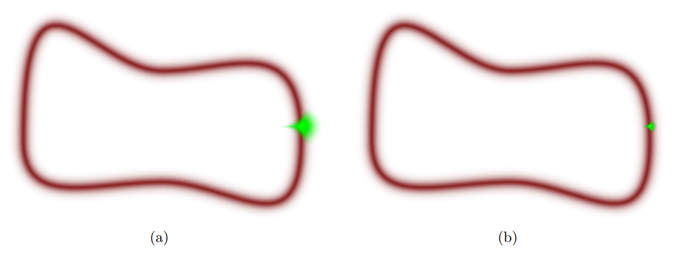
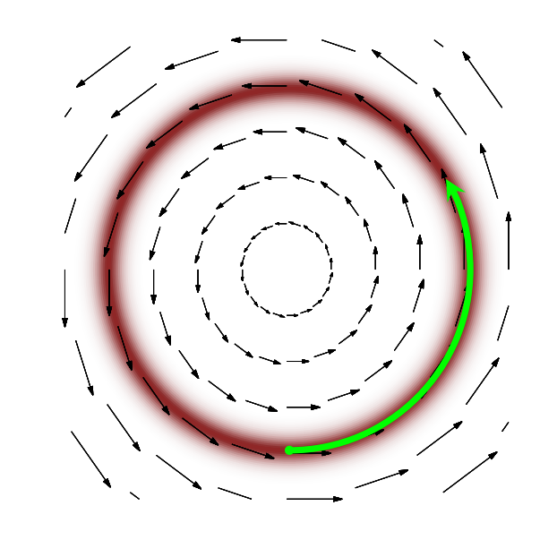
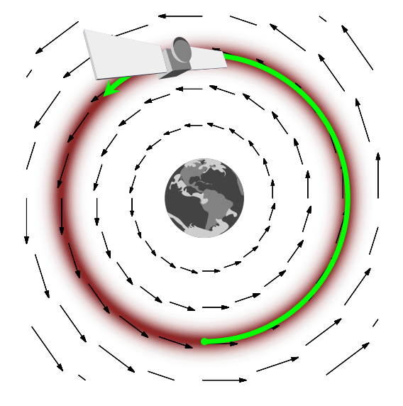

## Estimating Bayesian Models {.title-slide}

::: {style="display: none"}
$$
\DeclareMathOperator*{\argmin}{arg\,min}
\DeclareMathOperator*{\argmax}{arg\,max}
$$
:::

```{r, echo = F, message=F, warning=F}
library(tidyverse)
library(knitr)
library(broom)
options(digits=3)
knitr::opts_chunk$set(echo = T)
```

## Previously

::: {.incremental}

- **Bayesian inference**
  - The parameter $\theta$ is a **random** variable - probabilities describe our **beliefs** about it
  - Target of inference: the **posterior** $f(\theta | \mathbf{Y}) \propto f(\mathbf{Y} | \theta) \times f(\theta)$
  - **Conjugate priors** give posteriors with a closed form: Beta prior + Binomial likelihood $\leadsto$ Beta posterior

- **Application: absentee ballot rejection in Wisconsin**
  - Raw rejection rates (the MLE) in small municipalities are mostly noise
  - Pooling each municipality toward the statewide rate predicted better.

:::


## Connections with Frequentism

::: {.incremental}

- In our earlier example, under an uninformative uniform prior, the posterior mode is equivalent to the MLE
  - If $f(\theta) \propto 1$, $f(\theta|\mathbf{Y}) \propto f(\mathbf{Y}|\theta)$

- More generally, for most well-behaved priors and likelihoods, the **Bernstein-von Mises** theorem states that as $n \to \infty$...
  - ...the posterior distribution $f(\theta | \mathbf{Y})$ will converge to a **normal** distribution
  - ...centered at the MLE $\hat{\theta}$ (which is itself converging to the true parameter $\theta_0$)
  - ...with variance-covariance matrix equal to the inverse Fisher information

- Essentially: In large samples, posterior distributions converge to the sampling distribution of the MLEs

:::


## This week

::: {.incremental}

- **Markov Chain Monte Carlo** (MCMC)
  - Most posteriors don't have a closed form
  - Define an algorithm to **draw samples** from the posterior without knowing it directly.
  - The **Metropolis-Hastings** algorithm + **Gibbs sampling**

- **Introduction to Stan**
  - Write down the model
  - Let Stan implement the MCMC sampler (Hamiltonian Monte Carlo)

:::

## Markov Chain Monte Carlo

## Markov Chain Monte Carlo

::: {.incremental}

- In many settings, we have this problem in computing the posterior

  $$f(\theta | \mathbf{Y}) = \frac{\overbrace{f(\mathbf{Y}|\theta)}^{\text{Easy!}} \times \overbrace{f(\theta)}^{\text{Easy!}}}{\underbrace{f(\mathbf{Y})}_{\textbf{HARD!}}}$$

- The **prior** $f(\theta)$ has a known distribution (sometimes up to a proportionality constant)
- The **likelihood** $f(\mathbf{Y} | \theta)$ has a known distribution specified by our data-generating process
  - We write our model so that the joint density $f(\mathbf{Y}, \theta) = f(\mathbf{Y} | \theta) f(\theta)$ factors neatly

- But $f(\mathbf{Y})$ is a tough integral to evaluate!

  $$f(\mathbf{Y}) = \int f(\mathbf{Y},\theta)d\theta$$

- Last week we used a **conjugate prior**, which told us the form of the posterior without ever computing $f(\mathbf{Y})$

:::

## Markov Chain Monte Carlo

::: {.incremental}

- **Markov Chain Monte Carlo** methods generate a sample from the target posterior **even when we don't know it**
  - All we need is a function that is **proportional** to the posterior
  - **Monte Carlo**: Use repeated samples to obtain numeric approximations of key quantities
  - **Markov Chain**: The samples are constructed via a chain that has the Markov property

- **Our Goal**: Generate a Monte Carlo sample $\{\theta^{(1)}, \theta^{(2)}, \theta^{(3)}, \dotsc \}$ of arbitrary length
  - The sequence of draws should **converge** to a **stationary distribution** that is the target posterior

- This sample is a **Markov chain**: the distribution of the $(i+1)$th draw depends on the $i$th, but *only* on that past value

  $$f(\theta^{(i+1)} | \mathbf{Y},  \theta^{(i)}, \theta^{(i-1)}, \dotsc, \theta^{(1)}) =  f(\theta^{(i+1)} | \mathbf{Y},  \theta^{(i)})$$


:::

## Metropolis-Hastings Algorithm

- The foundational MCMC algorithm is **Metropolis-Hastings** [@metropolis1953equation; @hastings1970monte]. To generate a Markov chain of $M$ samples $\{\theta^{(1)}, \theta^{(2)}, \dotsc, \theta^{(M)}\}$, it iterates between two steps:

1. **Proposal**: Conditional on the current value $\theta$, generate a draw $\theta^*$ from the **proposal distribution** $Q(\theta^* | \theta)$ -- almost *any* distribution works (though some are better than others)
2. **Accept/Reject**: With **acceptance probability** $\alpha$, "accept" the proposal and set $\theta^{(i+1)} = \theta^*$ - otherwise "reject" and set $\theta^{(i+1)} = \theta$

  $$\alpha = \min\bigg\{1, \frac{f(\mathbf{Y}|\theta^*)f(\theta^*)}{f(\mathbf{Y}|\theta)f(\theta)} \times \frac{Q(\theta | \theta^*)}{Q(\theta^* | \theta)} \bigg\}$$

::: {.incremental}

- **Intuitively** - If the proposal distribution is symmetric...
  - ...if the unnormalized posterior density is higher at the proposed rather than the current location, **always accept**
  - ...if the unnormalized posterior density is lower at the proposed rather than current location, **maybe accept**
  - Note that $f(\mathbf{Y})$ would appear in both the numerator and the denominator -- it cancels!

:::

## Metropolis-Hastings Algorithm

::: {.incremental}

- To get some intuition, consider the case where somehow we could generate independent samples from the true posterior

  $$Q(\theta^*|\theta) = f(\theta^* | \mathbf{Y})$$

- What is our acceptance probability in this scenario?

  $$\frac{f(\mathbf{Y}|\theta^*)f(\theta^*)}{f(\mathbf{Y}|\theta)f(\theta)} \times \frac{f(\theta|\mathbf{Y})}{f(\theta^*|\mathbf{Y})} = \frac{f(\theta^*|\mathbf{Y})f(\mathbf{Y})}{f(\theta|\mathbf{Y})f(\mathbf{Y})} \times \frac{f(\theta|\mathbf{Y})}{f(\theta^*|\mathbf{Y})} = 1$$

- If we were somehow proposing from the true posterior distribution, Metropolis-Hastings would **always accept** each proposal!

:::

## Proposal Distribution

::: {.incremental}

- Our choice of $Q$ governs how quickly the Markov Chain will "converge" to the true posterior
  - We want a proposal distribution that could "eventually" propose each value in the domain of $\theta$
  - We also want a proposal distribution that generates a high acceptance probability $\alpha$

- It is common to choose a proposal distribution that is **symmetric** such that $$\frac{Q(\theta | \theta^*)}{Q(\theta^* | \theta)} = 1$$

- For $\theta \in (-\infty, \infty)$, it's common to propose $\theta^*$ from a $\text{Normal}(\theta, \Omega)$
  - A normal distribution centered on the "current" parameter with an arbitrarily chosen variance $\Omega$
  - This is **symmetric**: the chances of proposing $\theta^*$ from $\theta$ are the same as the chances of proposing $\theta$ from $\theta^*$

:::

## Proposal Distribution

::: {.incremental}

- Another alternative would be a $\text{Uniform}(\theta - \Delta, \theta + \Delta)$
  - Uniform distribution centered at $\theta$ where every value in the interval has density $\frac{1}{2\Delta}$

- For parameters that are constrained to $(0, 1)$, a simple choice would be to sample from the $\text{Uniform}(0,1)$
  - Trivially symmetric since the density is a constant.
  - But likely to generate bad proposals!

- A random walk still works for a constrained parameter
  - Proposals outside $(0, 1)$ have posterior density $0$, so they are always rejected

:::


## Illustration

- Let's go back to the absentee ballot data. Load it in just as we did last week

```{r, message = F, warning=F, echo=T}
# EAVS 2024, Wisconsin municipalities (see data/README.md)
wi <- read_csv("data/eavs_2024_wi.csv")
wi <- wi %>% mutate(n = C1b - C9b - C9m, y = C9a - C9b - C9m) %>% # Discretionary rejections only
  filter(n > 0) %>% # Drop municipalities where no absentee ballots were returned
  transmute(FIPSCode, municipality = Jurisdiction_Name, n, y, mle = y/n)
state_rate <- sum(wi$y)/sum(wi$n)
```

- And pull out the **City of Mequon**

```{r, echo=T}
mequon <- wi %>% filter(municipality == "CITY OF MEQUON - OZAUKEE COUNTY")
mequon
```

## Illustration

- Use last week's prior: centered on the rejection rate in the rest of the state, equivalent to 500 ballots

```{r, echo=T}
others_rate <- wi %>% filter(municipality != mequon$municipality) %>% summarize(rate = sum(y)/sum(n)) %>% pull(rate)
prior_alpha <- others_rate*500
prior_beta <- (1 - others_rate)*500
```

- The Beta prior is conjugate, so we know the posterior exactly

```{r, fig.width=6, fig.height = 3, fig.align="center"}
posterior_alpha <- mequon$y + prior_alpha
posterior_beta <- mequon$n - mequon$y + prior_beta
ggplot() + xlim(0, .02) + geom_function(fun=dbeta, args=list(shape1=posterior_alpha, shape2=posterior_beta), n=1001) +
  theme_bw() + xlab(expression(pi)) + ylab("Density")
```

- But suppose we couldn't calculate it directly?

## Illustration

::: {.incremental}

- Let's construct our MCMC sampler. First, let's choose a proposal distribution
  - For $\pi \in (0, 1)$, we could use a Beta, but the Beta isn't symmetric
  - $\text{Uniform}(0, 1)$ would generate a lot of bad proposals: the posterior is concentrated around $.008$

- Instead, use a **random walk**: propose $\pi^* \sim \text{Normal}(\pi, s^2)$, centered on the current value
  - It's **symmetric**, so the $Q$ terms cancel
  - The step size $s$ is chosen by the researcher: too small and the chain explores the posterior little-by-little, too large and most proposals are rejected
  - If $\pi^*$ falls outside $(0, 1)$, its posterior density is $0$: we always reject it

- We'll also work with the **log** of the likelihood and prior
  - Products of many small densities can underflow to $0$ -- sums of logs won't

:::

## Illustration

```{r, echo=T}
set.seed(53706)
M <- 50000  # Number of MCMC samples
pi_mcmc <- rep(NA, M) # Vector to store our samples
pi_mcmc[1] <- .5 # Pick a starting value
step_sd <- .003 # Standard deviation of the random-walk proposal
# The log of the unnormalized posterior: log likelihood + log prior
log_post <- function(p){
  if (p <= 0 | p >= 1) return(-Inf) # Zero posterior density outside (0, 1)
  dbinom(mequon$y, mequon$n, prob = p, log=T) + # Log likelihood
    dbeta(p, shape1 = prior_alpha, shape2 = prior_beta, log=T) # Log prior
}
```

## Illustration

```{r, echo=T}
for (i in 1:(M-1)){ # For i in 1:(M-1)
  ## Step 1 - Proposal
  pi_star <- rnorm(1, mean = pi_mcmc[i], sd = step_sd)
  ## Step 2 - Accept/Reject
  log_post_star <- log_post(pi_star)
  log_post_current <- log_post(pi_mcmc[i])
  log_Q_star_current <- dnorm(pi_star, mean = pi_mcmc[i], sd = step_sd, log=T) # This is all optional b/c of symmetry
  log_Q_current_star <- dnorm(pi_mcmc[i], mean = pi_star, sd = step_sd, log=T)
  # Assemble the acceptance ratio (exponentiate the difference in logs)
  ar <- exp(log_post_star - log_post_current + log_Q_current_star - log_Q_star_current)
  # Choose to accept or reject
  accept <- rbinom(1, 1, min(1, ar))
  # Store the next value
  pi_mcmc[i+1] <- pi_star*accept + pi_mcmc[i]*(1-accept)
}
```

- What share of proposals did we accept?

```{r, echo=T}
mean(diff(pi_mcmc) != 0)
```

## Illustration

- Let's first see how the chain progresses by generating the **trace plot** (the first 600 iterations)

```{r, fig.align="center", fig.height=3, fig.width=6}
plot(y=pi_mcmc[1:600], x=1:600, xlab="Iteration", ylab="pi", type="l")
```

::: {.incremental}

- The chain starts at $.5$ and takes about `r which(pi_mcmc < .02)[1]` iterations to reach the area of the posterior with the most mass
  - If we started closer to the "mass" of the distribution, we would have converged faster
- In practice, we will throw away some number of our initial samples as a **burn-in** period
  - The chain needs some time to reach the stationary distribution
  - Here we'll drop the first $1000$ samples and keep the rest

:::

## Illustration

- Our ideal trace plots have no clear trends - in such a case, we consider the chain to have reached its stationary distribution

```{r fig.align="center", fig.height=4, fig.width=7}
pi_mcmc_use <- pi_mcmc[1001:M] # Toss our burn-in period
plot(y=pi_mcmc_use, x=1:length(pi_mcmc_use), xlab="Iteration", ylab="pi", type="l")
```

- Trace plots are **diagnostics**: they can't prove that the chain has "mixed"
  - But a lot of jumps or stagnant periods would suggest that our chain needs to run longer...
  - ...or that we need a better proposal distribution!

## Illustration

- The MCMC draws (histogram) against the exact Beta posterior (red)

```{r,fig.align="center", fig.height=5, fig.width=7}
# Plot the histogram on top of the "true" distribution
data.frame(x=pi_mcmc_use) %>% ggplot(aes(x=x)) + theme_bw() + xlab(expression(pi)) + ylab("Density") +
  geom_histogram(aes(y=after_stat(density)), bins=50) +
  geom_function(fun=dbeta, args=list(shape1=posterior_alpha, shape2=posterior_beta), col="indianred", lwd=2)
```

## Illustration

- We can compute summaries like the posterior mean or a 95% credible interval by taking summaries of the MCMC sample

```{r, echo=T}
mean(pi_mcmc_use) # MCMC
posterior_alpha/(posterior_alpha + posterior_beta) # Exact
```

- We get very close to the true posterior (and can get closer with more iterations)

```{r, echo=T}
quantile(pi_mcmc_use, c(.025, .975)) # MCMC
qbeta(c(.025, .975), shape1=posterior_alpha, shape2=posterior_beta) # Exact
```

## Multiple parameters

::: {.incremental}

- In this example, we've focused on estimating a single parameter
  - Suppose instead we have $K$ parameters: $\theta = \{\theta_1, \theta_2, \theta_3, \dotsc, \theta_K\}$

- With multiple parameters, we'd need a multivariate proposal distribution (like a multivariate normal)
  - But this can be hard and mixing is often very slow with multivariate proposals.

- Instead, we can use **Gibbs sampling** [@geman1984stochastic; @gelfand1990sampling]
  - Generate each update $\theta^{(i+1)}_k$ conditional on the current values of the other parameters $\theta_{-k}$
  - If we **can** sample from the conditional distribution $\theta_k | \theta_{-k}, \mathbf{Y}$ we get proposals with acceptance probability 1
  - Even if we can't, we can use a M-H step for that parameter ("Metropolis-within-Gibbs")

:::

## Gibbs Sampling

- The **Gibbs sampling** algorithm generates updates $\theta^{(i+1)} = \{\theta^{(i+1)}_1, \theta^{(i+1)}_2, \theta^{(i+1)}_3, \dotsc, \theta^{(i+1)}_K\}$ by sampling in sequence:

$$\begin{align*}\theta_1^{(i+1)} &:= \theta^*_1 \sim f(\theta_1 | \mathbf{Y}, \theta_2^{(i)}, \theta_3^{(i)}, \dotsc \theta_K^{(i)})\\
 \theta_2^{(i+1)} &:= \theta^*_2 \sim f(\theta_2 | \mathbf{Y}, \theta_1^{(i+1)}, \theta_3^{(i)}, \dotsc \theta_K^{(i)})\\
 &\vdots\\
  \theta_k^{(i+1)} &:= \theta^*_k \sim f(\theta_k | \mathbf{Y}, \theta_1^{(i+1)}, \theta_2^{(i+1)}, \dotsc \theta_{k-1}^{(i+1)},\theta_{k+1}^{(i)} \dotsc, \theta_K^{(i)})\\
   &\vdots\\
  \theta_K^{(i+1)} &:= \theta^*_K \sim f(\theta_K | \mathbf{Y}, \theta_1^{(i+1)}, \theta_2^{(i+1)}, \dotsc \theta_{K-1}^{(i+1)})\end{align*}$$

::: {.incremental}

- **Important**: Sampling from the conditionals $f(\theta_k | \theta_{-k}, \mathbf{Y})$ is often easier than sampling from the marginal $f(\theta_k | \mathbf{Y})$.
  - We'll often introduce latent variables to make a Gibbs sampler work where it otherwise wouldn't. This is called **data augmentation**

:::

## Gibbs Sampling

- To see why sampling from the conditionals works, treat the conditional distribution $f(\theta_{k} | \theta_{-k}^{(i)} , \mathbf{Y})$ as the proposal distribution $Q$. The implied MH acceptance probability is

$$\alpha = \frac{f(\mathbf{Y}|\theta^*_k, \theta^{(i)}_{-k})f(\theta^*_k, \theta_{-k}^{(i)})}{f(\mathbf{Y}|\theta^{(i)}_k, \theta^{(i)}_{-k})f(\theta^{(i)}_k, \theta_{-k}^{(i)})} \times \frac{f(\theta^{(i)}_k|\mathbf{Y}, \theta_{-k}^{(i)})}{f(\theta^{*}_k|\mathbf{Y}, \theta_{-k}^{(i)})}$$

- Rewrite the numerator/denominator in terms of the posterior and the data (and recall that $f(\mathbf{Y})$ cancels)

$$\alpha = \frac{f(\theta^*_k, \theta^{(i)}_{-k}|\mathbf{Y})}{f(\theta^{(i)}_k, \theta^{(i)}_{-k}|\mathbf{Y})} \times \frac{f(\theta^{(i)}_k|\mathbf{Y}, \theta_{-k}^{(i)})}{f(\theta^{*}_k|\mathbf{Y}, \theta_{-k}^{(i)})}$$

## Gibbs Sampling

- Factor the posteriors

$$\alpha = \frac{f(\theta^*_k| \theta^{(i)}_{-k},\mathbf{Y}) \times f(\theta^{(i)}_{-k}|\mathbf{Y})}{f(\theta^{(i)}_k | \theta^{(i)}_{-k}, \mathbf{Y}) \times f(\theta^{(i)}_{-k}|\mathbf{Y})} \times \frac{f(\theta^{(i)}_k|\mathbf{Y}, \theta_{-k}^{(i)})}{f(\theta^{*}_k|\mathbf{Y}, \theta_{-k}^{(i)})}$$

::: {.incremental}

- Everything cancels so that $\alpha = 1$
  - So Gibbs sampling is a special case of Metropolis-Hastings where the proposal distribution choice **guarantees** acceptance.

- But, we need to know the conditional distributions $f(\theta_k | \theta_{-k}, \mathbf{Y})$
  - This is where **conjugacy** comes back in!

:::

## Bayesian Regression

## Bayesian Normal Model

::: {.incremental}

- The conventional "normal" Bayesian regression model assumes

  $$Y_i | X_i, \beta, \sigma^2 \sim \text{Normal}(X_i^{\prime}\beta, \sigma^2)$$
  $$\beta | \sigma^2 \sim \text{Normal}(b_0, \sigma^2B^{-1}_0)$$
  $$\sigma^2 \sim \text{Inverse-Gamma}\left(\frac{c_0}{2}, \frac{d_0}{2}\right)$$

- $b_0$, $B_0$, $c_0$ and $d_0$ are all hyperparameters

- This is the "Normal-Inverse-Gamma" model: the joint prior on $\beta, \sigma^2$ is Normal-Inverse-Gamma
  - It is also the **conjugate prior** for the normal regression with unknown $\beta$ and $\sigma^2$
  - So the posterior is known in closed form to be **Normal-Inverse-Gamma**

- A common simplification is to make $\beta$ and $\sigma^2$ marginally independent

  $$\beta \sim \text{Normal}(b_0, B_0^{-1})$$

:::

## Plate notation

```{tikz, dag2, echo=F, fig.align='center'}
\usetikzlibrary{arrows}
\usetikzlibrary{bayesnet}
\begin{tikzpicture}
\node[obs] (y) {$Y_i$};
\node[const, above=of y] (x) {$X_i$};
\node[latent, right=of x] (beta) {$\beta$};
\node[latent, right=of y] (sigma) {$\sigma^2$};
\node[const, right=of beta,] (beta0) {$b_0$};
\node[const, right=of beta, yshift=-.5cm] (B0) {$B_0$};
\node[const, right=of sigma ] (alpha0) {$c_0$};
\node[const, right=of sigma, yshift=-.5cm] (delta0) {$d_0$};
\edge{x}{y};
\edge{beta}{y};
\edge{sigma}{y};
\edge{beta0}{beta};
\edge{B0}{beta};
\edge{alpha0}{sigma};
\edge{delta0}{sigma};
\plate [inner sep=.3cm] {plate1} {(y) (x)} {$N$};
\end{tikzpicture}
```

- With independent priors, there is no arrow from $\sigma^2$ to $\beta$

## Aside: Conditional distributions

::: {.incremental}

- To build a Gibbs sampler for $f(\beta, \sigma^2 | \mathbf{Y})$, we need the conditionals $f(\beta | \mathbf{Y}, \sigma^2)$ and $f(\sigma^2 | \mathbf{Y}, \beta)$.
  - Can we derive them (or at least their distributional forms?)

- Deriving these conditionals often relies on inspecting a density that is **proportional** to the conditional density and recognizing its form.
  - Remember the connection between **conditional** and **joint** densities, as well as how **joint** densities factor.

- From the definition of a conditional density: joint divided by marginal

  $$f(\beta | \mathbf{Y}, \sigma^2) = \frac{f(\beta, \sigma^2 | \mathbf{Y})}{f(\sigma^2 | \mathbf{Y})}$$

- Since we treat $\sigma^2$ here as a constant, we can write

  $$f(\beta | \mathbf{Y}, \sigma^2) \propto f(\beta, \sigma^2 | \mathbf{Y}) \propto f(\mathbf{Y} | \beta, \sigma^2)f(\beta, \sigma^2)$$

- where the last part follows from Bayes' rule

:::

## Aside: Conditional distributions

::: {.incremental}

- Next, remember how distributions factor

  $$f(\beta, \sigma^2) = f(\beta | \sigma^2)f(\sigma^2)$$

- If $\beta$ and $\sigma^2$ are marginally independent, then the joint distribution factors into the **marginals**
  - But even if they're not independent, we can always factor into a product of conditionals

- So we have

  $$f(\beta | \mathbf{Y}, \sigma^2) \propto f(\mathbf{Y} | \beta, \sigma^2)f(\beta | \sigma^2) f(\sigma^2)$$

- Again, $\sigma^2$ is a constant here, so that last density drops as a multiplicative constant

  $$f(\beta | \mathbf{Y}, \sigma^2) \propto f(\mathbf{Y} | \beta, \sigma^2)f(\beta | \sigma^2)$$

:::

## Aside: Conditional distributions

::: {.incremental}

- With independent priors, $f(\beta | \sigma^2) = f(\beta)$

  $$f(\beta | \mathbf{Y}, \sigma^2) \propto f(\mathbf{Y} | \beta, \sigma^2)f(\beta)$$

- And independence of observations gives

  $$f(\beta | \mathbf{Y}, \sigma^2) \propto \bigg[\prod_{i=1}^N f(Y_i | \beta, \sigma^2)\bigg]f(\beta)$$

- The key is finding densities that are given by our model description - now all of these factors are known

  $$f(\beta | \mathbf{Y}, \sigma^2) \propto \bigg[\prod_{i=1}^N \underbrace{f(Y_i | \beta, \sigma^2)}_{\text{Normal}(X_i^{\prime}\beta, \sigma^2)}\bigg]\times\underbrace{f(\beta)}_{\text{Normal}(b_0, B_0^{-1})}$$

- One useful property from probability theory: the product of two normal PDFs is proportional to a normal PDF
  - So $\beta | \mathbf{Y}, \sigma^2$ is normal!

:::

## Normal-normal conjugacy

::: {.incremental}

- The algebra is cleaner in terms of the **precision** $\tau^2 = 1/\sigma^2$ rather than the variance

- To see why the normal is conjugate to the normal, plug in the densities and drop multiplicative constants

  $$f(\beta | \mathbf{Y}, \tau^2) \propto \bigg[\prod_{i=1}^N \exp\bigg(-\frac{\tau^2}{2}(Y_i - X_i^\prime \beta)^2\bigg)\bigg]\times \exp\bigg(-\frac{1}{2}(\beta - b_0)^{\prime}B_0(\beta - b_0)\bigg)$$

- A product of exponentials is the exponential of a sum. Write the sum of squares in matrix form

  $$f(\beta | \mathbf{Y}, \tau^2) \propto \exp\bigg(-\frac{\tau^2}{2}(\mathbf{Y} - \mathbf{X}\beta)^\prime (\mathbf{Y} - \mathbf{X}\beta)\bigg)\times \exp\bigg(-\frac{1}{2}(\beta - b_0)^\prime B_0(\beta - b_0)\bigg)$$

- Expand both quadratic forms and drop the terms that don't involve $\beta$ (they're constants)

  $$f(\beta | \mathbf{Y}, \tau^2) \propto \exp\bigg(-\frac{1}{2}\bigg[\beta^\prime \big(\tau^2\mathbf{X}^\prime \mathbf{X}\big)\beta - 2\beta^\prime \tau^2\mathbf{X}^\prime \mathbf{Y} \bigg]\bigg)\times \exp\bigg(-\frac{1}{2}\bigg[\beta^\prime B_0\beta - 2\beta^\prime B_0 b_0\bigg]\bigg)$$

:::

## Normal-normal conjugacy

::: {.incremental}

- Collect terms

  $$f(\beta | \mathbf{Y}, \tau^2) \propto \exp\bigg(-\frac{1}{2}\bigg[\beta^\prime \big(B_0 + \tau^2\mathbf{X}^\prime \mathbf{X}\big)\beta - 2\beta^\prime \big(B_0 b_0 + \tau^2\mathbf{X}^\prime \mathbf{Y}\big) \bigg]\bigg)$$

- "Completing the square": call the matrix in the first term $V^{-1}$ and write the vector in the second as $V^{-1}\mu$

  $$\beta^\prime V^{-1}\beta - 2\beta^\prime V^{-1}\mu = (\beta - \mu)^\prime V^{-1}(\beta - \mu) - \mu^\prime V^{-1}\mu$$

  - The last term doesn't involve $\beta$, so it drops out

  $$f(\beta | \mathbf{Y}, \tau^2) \propto \exp\bigg(-\frac{1}{2}(\beta - \mu)^\prime V^{-1}(\beta - \mu)\bigg)$$

- We recognize this as the kernel of a multivariate normal with **variance-covariance matrix** $V$ and **mean** $\mu$

  $$V = \big(B_0 + \tau^2\mathbf{X}^{\prime}\mathbf{X}\big)^{-1}, \qquad \mu = V\big(B_0b_0 + \tau^2\mathbf{X}^{\prime}\mathbf{Y}\big)$$

:::

## Normal-normal conjugacy

::: {.incremental}

- The posterior **precision** $V^{-1} = B_0 + \tau^2\mathbf{X}^\prime\mathbf{X}$ is the prior precision plus the precision from the data
  - The mean is a precision-weighted combination of the prior mean $b_0$ and the data
  - Just like the Beta-Binomial: the weight on the prior shrinks as $N$ grows

- As $N \to \infty$, $\tau^2\mathbf{X}^\prime\mathbf{X}$ swamps $B_0$...
  - ...so $\mu \to (\mathbf{X}^\prime\mathbf{X})^{-1}\mathbf{X}^\prime\mathbf{Y}$ (OLS!) and $V \to (\tau^2\mathbf{X}^\prime\mathbf{X})^{-1}$

- The same steps give the other conditional: with $\text{SSR}(\beta) = (\mathbf{Y} - \mathbf{X}\beta)^\prime(\mathbf{Y} - \mathbf{X}\beta)$

  $$\tau^2 | \mathbf{Y}, \beta \sim \text{Gamma}\bigg(\frac{c_0 + N}{2}, \frac{d_0 + \text{SSR}(\beta)}{2}\bigg)$$

  - (shape, rate) -- the $\text{Inverse-Gamma}(c_0/2, d_0/2)$ prior on $\sigma^2$ is a $\text{Gamma}(c_0/2, d_0/2)$ prior on $\tau^2$

- So our Gibbs sampler alternates between two easy draws: $\beta$ from a normal, $\tau^2$ from a gamma
  - (Under the conjugate prior $\beta | \tau^2 \sim \text{Normal}(b_0, (\tau^2 B_0)^{-1})$, the conditional instead has $V = \big(\tau^2(B_0 + \mathbf{X}^\prime\mathbf{X})\big)^{-1}$ and $\mu = (B_0 + \mathbf{X}^\prime\mathbf{X})^{-1}(B_0 b_0 + \mathbf{X}^\prime\mathbf{Y})$)

:::

## Application: Do rejection rates persist?

::: {.incremental}

- Last week we saw that the municipalities with the highest 2024 rates still rejected well above the statewide rate in 2022
  - Is there a **systematic** relationship between a municipality's past and present rejection rates?
  - If clerks differ in how strictly they apply the rules, we'd expect the same places to reject more ballots election after election

- Our outcome is a **count** of rejected ballots
  - So we'll fit a **binomial logistic regression** with the 2022 rejection rate $x_i$ (in percentage points) as the predictor
  - We'll put a normal prior on the $\beta$ coefficients.

  $$Y_i \sim \text{Binomial}(n_i, \pi_i)$$
  $$\log\bigg(\frac{\pi_i}{1 - \pi_i}\bigg) = \beta_0 + \beta_1 x_i$$
  $$\beta_0, \beta_1 \sim \text{Normal}(0, 5^2)$$

:::

## Plate notation

```{tikz, dag3, echo=F, fig.align='center'}
\usetikzlibrary{arrows}
\usetikzlibrary{bayesnet}
\begin{tikzpicture}
\node[obs] (y) {$Y_i$};
\node[det, above=of y] (pi) {$\pi_i$};
\node[const, left=of pi] (x) {$x_i$};
\node[const, left=of y] (n) {$n_i$};
\node[latent, right=of pi] (beta) {$\beta$};
\node[const, right=of beta] (s) {$5$};
\edge{x}{pi};
\edge{n}{y};
\edge{beta}{pi};
\edge{pi}{y};
\edge{s}{beta};
\plate [inner sep=.3cm] {plate1} {(y) (pi) (x) (n)} {$N$};
\end{tikzpicture}
```

- $\pi_i$ is now a **deterministic** quantity: a transformation of $\beta$ and $x_i$

## No conjugate prior

::: {.incremental}

- The posterior is (writing $X_i = (1, x_i)^\prime$, so $X_i^\prime\beta = \beta_0 + \beta_1 x_i$)

  $$f(\beta | \mathbf{Y}) \propto \prod_{i=1}^N \bigg[\text{logit}^{-1}(X_i^\prime\beta)^{Y_i}\big(1 - \text{logit}^{-1}(X_i^\prime\beta)\big)^{n_i - Y_i}\bigg] \times \underbrace{\exp\bigg(-\frac{\beta^\prime\beta}{2 \times 5^2}\bigg)}_{\text{Normal}(0, 5^2) \text{ priors}}$$

- This isn't any distribution we recognize, and there's no prior we could choose to make it workable.
  - There is no conjugate prior for the logit
  - (There are data augmentation tricks that give a Gibbs sampler - easier for the probit)

- But we can **evaluate** it for any $\beta$ - and that's all we need to implement 

:::

## Metropolis-Hastings for the logit

- Load the 2022 data and compute each municipality's 2022 discretionary rejection rate

```{r, message = F, warning=F, echo=T}
wi_2022 <- read_csv("data/eavs_2022_wi.csv") %>%
  # 2022 files the Village of Greenville under the old town's code (see data/README.md)
  mutate(FIPSCode = if_else(str_detect(Jurisdiction_Name, "VILLAGE OF GREENVILLE"), "31525", FIPSCode)) %>%
  mutate(n_2022 = C1b - C9b - C9m, y_2022 = C9a - C9b - C9m) %>% filter(n_2022 > 0) %>%
  transmute(FIPSCode, rate_2022 = 100*y_2022/n_2022) # In percentage points
wi <- wi %>% inner_join(wi_2022, by="FIPSCode") # Municipalities with ballots in both years
```

- Set up the regression (`r nrow(wi)` municipalities)

```{r, echo=T}
X_mat <- model.matrix(~ rate_2022, data=wi)
K <- ncol(X_mat) # Number of beta parameters
```

## Metropolis-Hastings for the logit

- Write a function to evaluate the log of the unnormalized posterior

```{r, echo=T}
log_post_logit <- function(b){
  log_lik <- sum(dbinom(wi$y, wi$n, prob = plogis(X_mat %*% b), log=T))
  log_prior <- sum(dnorm(b, mean = 0, sd = 5, log=T))
  log_lik + log_prior
}
```

- Set up the MCMC

```{r, echo=T}
M <- 20000  # Number of MCMC samples
burnin <- 5000
beta_mcmc <- matrix(nrow = M, ncol=K) # Matrix to store our samples
beta_mcmc[1,] <- c(0, 0) # Pick a starting value
```

## Metropolis-Hastings for the logit

- A "random walk" proposal: a bivariate normal centered on the current value

```{r, echo=T}
set.seed(53706)
log_post_current <- log_post_logit(beta_mcmc[1,])
for (i in 1:(M-1)){ # For i in 1:(M-1)
  ## Step 1 - Proposal
  beta_star <- beta_mcmc[i,] + rnorm(K, mean = 0, sd = .02)
  ## Step 2 - Accept/Reject
  log_post_star <- log_post_logit(beta_star)
  ar <- exp(log_post_star - log_post_current) # Symmetric proposal, so no Q terms
  accept <- rbinom(1, 1, min(1, ar))
  if (accept == 1){
    beta_mcmc[i+1,] <- beta_star
    log_post_current <- log_post_star # Save the log posterior so we don't recompute it
  } else {
    beta_mcmc[i+1,] <- beta_mcmc[i,]
  }
}
beta_mcmc_use <- beta_mcmc[(burnin+1):M,] # Toss our burn-in period
```

## Convergence

- $\beta_1$ (the coefficient on the 2022 rate $x_i$), *including* the burn-in period

```{r, fig.align="center", fig.height=4, fig.width=7}
plot(y=beta_mcmc[,2], x=1:M, xlab="Iteration", ylab="beta_1", type="l")
abline(v=burnin, lty=2, col="indianred")
```

## Convergence

- Both parameters after the burn-in

```{r, fig.align="center", fig.height=3.5, fig.width=10}
par(mfrow=c(1,2))
plot(y=beta_mcmc_use[,1], x=1:nrow(beta_mcmc_use), xlab="Iteration", ylab="beta_0", type="l")
plot(y=beta_mcmc_use[,2], x=1:nrow(beta_mcmc_use), xlab="Iteration", ylab="beta_1", type="l")
```

- $\beta_1$ bounces around its posterior quickly, but the $\beta_0$ chain **wanders**: each draw is highly correlated with the last

## Convergence

- Why? Plot the draws of $\beta_0$ against $\beta_1$, with both axes on the **same scale**

```{r, fig.align="center", fig.height=3, fig.width=9}
data.frame(beta_mcmc_use) %>% ggplot(aes(x=X1, y=X2)) + geom_point(alpha=.05) + coord_fixed() + theme_bw() +
  xlab(expression(beta[0])) + ylab(expression(beta[1]))
```

::: {.incremental}

- The posterior is much wider in $\beta_0$ (SD `r round(sd(beta_mcmc_use[,1]), 3)`) than in $\beta_1$ (SD `r round(sd(beta_mcmc_use[,2]), 3)`)
- Our proposal takes the same size step ($\text{SD} = .02$) in both directions
  - Large relative to the spread in $\beta_1$: many proposals land in low-density regions and get rejected
  - Small relative to the spread in $\beta_0$: crossing the posterior takes many steps

:::

## Effective sample size

::: {.incremental}

- Dependent draws carry less information than independent ones
  - The **effective sample size** (ESS) is the number of *independent* draws that would give an equally precise estimate of the posterior mean

:::

```{r, echo=T}
coda::effectiveSize(beta_mcmc_use)
```

::: {.incremental}

- We kept `r nrow(beta_mcmc_use)` draws, but for $\beta_0$ they are worth only about `r round(min(coda::effectiveSize(beta_mcmc_use)), -1)` independent ones
  - We could fix this by running much longer, or by **tuning** the proposal to match the shape of the posterior
  - Or we could use a smarter algorithm...

:::

## Summaries

- Posterior means and 95% credible intervals

```{r, echo=T}
beta_mcmc_out <- as.data.frame(beta_mcmc_use)
colnames(beta_mcmc_out) <- c("Intercept", "rate_2022")
data.frame(variable = c("Intercept", "rate_2022"), pm = colMeans(beta_mcmc_out),
           ci95_lower = apply(beta_mcmc_out, 2, function(x) quantile(x, .025)),
           ci95_upper = apply(beta_mcmc_out, 2, function(x) quantile(x, .975)))
```

- Compare to the MLE (with `r nrow(wi)` municipalities and a diffuse prior, Bernstein-von Mises says these should be close)

```{r, echo=T}
glm(cbind(y, n - y) ~ rate_2022, data = wi, family = binomial) %>% tidy(conf.int = T) %>%
  select(term, estimate, conf.low, conf.high)
```

## Intro to Stan/HMC

## Overview of HMC

::: {.incremental}

- **Hamiltonian Monte Carlo** improves on the conventional Metropolis-Hastings algorithm by improving the **proposals** so that they are accepted with very high probability

- The method draws on a theoretical core from differential geometry, but it's not strictly necessary to get the intuition for it.
  - @betancourt2017conceptual is a good overview for applied researchers (familiarity with statistics but not physics)

- MCMC (ideally) works in 3 general phases
  1. From the starting values, reach the "typical set" of parameter values that occupy most of the posterior mass
  2. The MCMC traverses the "typical set" of values once.
  3. Repeated traversals improve the quality of the MCMC approximation.

- Problems arise when Markov Chains
  1. Don't traverse high density parts of the posterior
  2. Get *stuck* in parts of the density.

:::

## Overview of HMC

- Typical distributions for $Q$ are random walks
  - In high dimensions, these tend to be **bad** proposals.

- One solution is to choose a low variance for the random walk
  - This leads to high autocorrelation in the proposals (we just saw this!)

{fig-align='center' width=600}

## Overview of HMC

- What if we could come up with a "direction" to point our proposal (or sequence of proposals) that stayed in the "typical set"
  - Is there another way to get proposals with an acceptance probability of 1 besides Gibbs sampling?

{fig-align='center' width=400}

## Overview of HMC

::: {.incremental}

- Instead of sampling just from $f(\theta | \mathbf{Y})$, we'll introduce a set of auxiliary "momentum" variables $\rho$ and sample from the joint density $f(\rho, \theta | \mathbf{Y})$.
  - We'll generate samples of $\rho$ and "evolve" $\theta$ in a particular manner.

- That density factors such that if we integrated out the auxiliary variables, we'd get the target.

  $$f(\rho, \theta | \mathbf{Y}) = f(\rho | \theta, \mathbf{Y})f(\theta | \mathbf{Y})$$

- And we'll typically pick a distribution on $\rho$ that is independent of the parameter values.

  $$f(\rho, \theta | \mathbf{Y}) = f(\rho)f(\theta | \mathbf{Y})$$

- If I propose $\rho^*$ randomly, how do I find a $\theta^*$ such that $f(\rho, \theta | \mathbf{Y}) = f(\rho^*, \theta^* |\mathbf{Y})$ and my acceptance probability is $1$?

:::

## Overview of HMC

- The joint density defines a **Hamiltonian** $H(\rho, \theta)$ - in the physics analogy, this is the "total energy" of our system.

  $$\begin{align*}H(\rho, \theta) &= -\log f(\rho, \theta | \mathbf{Y})\\
&= - \log f(\rho) - \log f(\theta | \mathbf{Y})\\
&= T(\rho) + V(\theta)\end{align*}$$

  - $T(\rho)$ is the "kinetic energy" and $V(\theta)$ is the "potential energy"

- Energy is conserved in this system. So if we randomly choose $\rho$ and then jointly evolve $\rho$ and $\theta$ according to **Hamilton's equations**, every point we reach has the same joint density - a proposal that is guaranteed to be accepted.

  $$\begin{align*}\frac{d\theta}{dt} &= + \frac{\partial H}{\partial \rho} = \frac{\partial{T}}{\partial{\rho}}\\
\frac{d\rho}{dt} &= -\frac{\partial H}{\partial \theta} = -\frac{\partial V}{\partial{\theta}}\end{align*}$$

## Overview of HMC

- **HMC Algorithm** (in Stan)
  - Propose $\rho^* \sim \text{MultivariateNormal}(0, M)$
  - Evolve the joint system of $\rho^*, \theta^*$ using Hamilton's equations for some number of steps
  - Metropolis accept/reject the proposed new set of values (we can only *approximate* the solution, so the energy isn't exactly conserved)
  - Stan's default, the **No-U-Turn Sampler** (NUTS), also chooses the number of steps automatically [@hoffman2014nuts]

{fig-align='center' width=400}

## Overview of HMC

::: {.incremental}

- **Central intuitions**
  - Hamiltonian Monte Carlo is designed to generate proposals with **high acceptance probability**
  - These proposals require knowing the **gradient** of the unnormalized posterior with respect to the parameters

- Analytical computation of the gradient is tedious
  - Numeric computation can be unstable.
  - Many modern techniques use **automatic** differentiation

- **Intuition**: Decompose the unnormalized posterior into a series of elementary arithmetic operations and functions where derivatives are trivially known
  - Use the **chain rule** to construct the gradient from the component functions + their derivatives.

- **Downside**: Can't use HMC for *discrete* parameters (but can often just marginalize those out).

:::

## Overview of Stan

- `Stan` is a C++ library that implements a version of Hamiltonian Monte Carlo [@standevteam2024stan]
  - Latest iteration of the "model-to-MCMC" libraries like `JAGS` and `BUGS` (which are Gibbs samplers)

- Key Features
  1. Language agnostic - has interfaces in R, Python, Julia, Stata, etc...
  2. Fast run-time
  3. High-level language for specifying models to be converted to C++ code.

- Complications
  - Running Stan requires you to have the ability to compile C++ code locally
  - Stan also requires learning a slightly new syntax

## Stan resources

- [Installation Quick Start Guide](https://github.com/stan-dev/rstan/wiki/RStan-Getting-Started)
- [Stan User's Guide](https://mc-stan.org/docs/stan-users-guide/index.html)
- [Stan Reference Manual](https://mc-stan.org/docs/reference-manual/index.html)
- [Stan Functions Reference](https://mc-stan.org/docs/functions-reference/index.html)
- [A good model building tutorial for social scientists by Jim Savage](https://rpubs.com/jimsavage/stanintro)

## Installing RStan

- We're working with R, so we'll be using the `rstan` interface to Stan
- **To Install**
  - Install the **R-Universe** version directly from [mc-stan.org/install](https://mc-stan.org/install)
  - There is a nice guide at [https://github.com/stan-dev/rstan/wiki/RStan-Getting-Started](https://github.com/stan-dev/rstan/wiki/RStan-Getting-Started)
  - Follow the instructions specific to your OS!

```{r, eval=F, echo=T}
# run the next line if you already have rstan installed
# remove.packages(c("StanHeaders", "rstan"))
install.packages("rstan", repos = c('https://stan-dev.r-universe.dev', getOption("repos")))
```

## Installing RStan

- In order to run Stan, your computer needs to be able to compile C++ code. This requires some auxiliary installs that depend on your operating system
  - **Windows**: You need to install `Rtools`. See instructions: [RStan wiki: Windows toolchain](https://github.com/stan-dev/rstan/wiki/Configuring-C---Toolchain-for-Windows)
  - **Mac**: You need the Xcode command line tools and a configured C++ toolchain. The `macrtools` package sets both up. See instructions: [RStan wiki: Mac toolchain](https://github.com/stan-dev/rstan/wiki/Configuring-C---Toolchain-for-Mac)
  - **Linux**: You need `g++` or `clang++` - one tends to be installed by default or is available from your repositories.

## Writing a Stan program

- Stan programs define a statistical model through a sequence of blocks that identify the data (modeled and unmodeled), parameters, and statistical model.
  - These are then translated to C++ and compiled. Because Stan uses C++, variables need to be declared differently from a language like R.
  - C++ is **statically typed** - the *type* of a variable needs to be fixed when it is declared.

## Writing a Stan program

- Primary variable types and their syntax
  - `int`: Integer and `real`: continuous values
  - `vector` and `matrix` for real-valued column vectors and matrices
  - `array` gives an array of any type (like an integer). Stan versions before 2.26 used a different syntax for this.

- If variables are constrained, add `<lower = .>` and `<upper = .>` to the declaration.

- **Minor notes**
  - Stan programs in R can be saved as separate files (with a `.stan` suffix) or in a length 1 character vector (directly typed into R).
  - Lines end with semi-colons `;`
  - `//` denotes a comment

## Program blocks

- `data`: Defines the modeled (e.g. $Y$) and unmodeled data (e.g. $X$) that are used in the model.
  - Includes any important constants (like the sample size $N$) or the number of parameters $K$ that you don't hard-code.
  - When compiling and estimating the model, you'll pass in R objects for each entry defined in `data` through a list

- Example data block (for our binomial logistic regression):

```stan
data {
  int N; // number of municipalities
  int K; // number of covariates
  matrix[N, K] X; // matrix of covariates
  array[N] int<lower=0> n; // number of ballots returned
  array[N] int<lower=0> y; // number of ballots rejected
}
```

## Program blocks

- `parameters`: Defines the parameters of interest whose posterior density we're trying to sample from

- Example parameters block:

```stan
parameters {
  vector[K] beta; // regression coefficients
}
```

## Program blocks

- `model`: Defines the statistical distributions of the observed data + the parameters
  - Likelihood and prior distributions

- Example model block:

```stan
model {
  beta ~ normal(0, 5); // normal prior
  y ~ binomial_logit(n, X * beta); // binomial outcome (logit link)
}
```

## Program blocks

- We can use for loops as well (can be useful for more complicated DGPs)

```stan
model {
  for (k in 1:K){
    beta[k] ~ normal(0, 5);
  }
  for (i in 1:N){
    y[i] ~ binomial_logit(n[i], X[i] * beta);
  }
}
```

## Program blocks

- Other useful (but not required) blocks
  - `functions`: Contains user-defined functions that can be used within the remainder of the model definition (or made available to R)
  - `transformed data`, `transformed parameters`: Contains deterministic transformations of either the data or the parameters.
  - `generated quantities`: Computes quantities from each posterior draw after estimation (e.g. predictions, simulated data, model summary statistics)

## Application: Ballot rejection in Stan

- Let's implement our binomial logistic regression in Stan

```{r, echo=T}
model_structure <- "
data {
  int N; // number of municipalities
  int K; // number of covariates
  matrix[N, K] X; // covariate matrix
  array[N] int<lower=0> n; // number of ballots returned
  array[N] int<lower=0> y; // number of ballots rejected
}
parameters {
  vector[K] beta; // regression coefficients
}
model {
  beta ~ normal(0, 5); // normal prior
  y ~ binomial_logit(n, X * beta); // binomial outcome (logit link)
}
generated quantities {
  // predicted 2024 rejection rates for a municipality that rejected 0% vs. 5% in 2022
  real rate_0 = inv_logit(beta[1]);
  real rate_5 = inv_logit(beta[1] + beta[2] * 5);
}
"
```

## Application: Ballot rejection in Stan

- Load the relevant packages

```{r, warning=F, message=F, results=F, echo=T}
library(rstan)
```

- Pass the data as a list (names must match the `data` block)

```{r, echo=T}
data_source <- list(N = nrow(X_mat), K = ncol(X_mat), X = X_mat, n = wi$n, y = wi$y)
```

## Application: Ballot rejection in Stan

- Run Stan! (The first run takes a minute: Stan has to compile the model to C++)

```{r stan-fit, echo=T, message=F, warning=F, results=F, cache=T, cache.extra=list(model_structure, data_source)}
model_fit <- stan(
  model_code = model_structure,  # Stan code
  data = data_source,     # named list of data
  chains = 4,             # number of Markov chains
  warmup = 500,           # number of warmup iterations per chain
  iter = 2500,            # total number of iterations per chain
  cores = 4,              # number of cores (could use one per chain - by default uses however many you have)
  refresh = 0,            # no progress shown
  seed = 53706
  )
```

- The **warmup** iterations are like a burn-in, but Stan also uses them to tune the sampler

## Convergence

- The `traceplot` function lets us plot trace plots of any parameters or generated quantities. Let's do it for $\beta$

```{r, fig.align="center", fig.width=10, fig.height=5, echo=T}
traceplot(model_fit, pars = c("beta"))
```

- Four chains, started at different random values, all exploring the same region -- no wandering

## Convergence

::: {.incremental}

- Running **multiple chains** gives us another diagnostic
  - If every chain has converged to the posterior, they should all look alike
  - $\hat{R}$ ("R-hat") compares the variation *between* chains to the variation *within* them
  - $\hat{R} \approx 1$ when the chains agree; values above about $1.01$ are a warning sign

- Stan also reports the **effective sample size** (`n_eff`) for each parameter
  - Gives a sense of the Monte Carlo approximation error - this isn't for statistical inference!

- Stan will also warn you about **divergent transitions**
  - The simulated trajectory went somewhere the sampler couldn't follow
  - Usually a sign of a posterior with a difficult shape!

:::

## Summary

- Summarize the fit

```{r, echo=T}
print(model_fit, pars = c("beta", "rate_0", "rate_5"), digits_summary = 4)
```

- Compare `n_eff` to our random-walk sampler's `r round(coda::effectiveSize(beta_mcmc_use)[1])` for $\beta_0$, from `r nrow(beta_mcmc_use)` draws

## Summary

- Plot the results

```{r, message=F, fig.align="center", fig.width=7, fig.height=4}
stan_plot(model_fit, pars = c("beta[2]"))
```

## Summary

- There's cooler-looking stuff in `bayesplot`

```{r, message=F, echo=T}
library(bayesplot)
```

```{r, message=F, fig.align="center", fig.width=7, fig.height=4, echo=T}
mcmc_areas(model_fit, pars = c("rate_0", "rate_5"), prob = .95) +
  scale_x_continuous(labels = scales::percent) + xlab("Predicted 2024 rejection rate")
```

## Summary

```{r, echo=F}
beta_1_draws <- rstan::extract(model_fit, "beta")$beta[,2]
```

::: {.incremental}

- Municipalities that rejected more ballots in 2022 reject **more** in 2024
  - Each additional percentage point of 2022 rejections multiplies the 2024 odds of rejection by about `r round(exp(mean(beta_1_draws)), 2)`
  - `r sum(beta_1_draws > 0)` of the `r length(beta_1_draws)` posterior draws of $\beta_1$ are positive

- But is this model any **good**?
  - **Next week:** How do we diagnose Bayesian models?

:::

## Next week

::: {.incremental}

- **Multilevel models**
  - How do we use known **grouping** to provide structure when estimating model parameters
  - **Partial pooling** for varying intercepts and slopes

- **Model validation**
  - Posterior predictive checks: does the model reproduce the data?
  - Comparing models with cross-validation

- **Multilevel regression and post-stratification (MRP)**

- **Readings:** Chapter 11 and Appendix A of @gelman2020ros; Chapter 15 of @gelman2013bda; @park2004bayesian

:::

## References {.refs-slide}

::: {#refs}
:::
